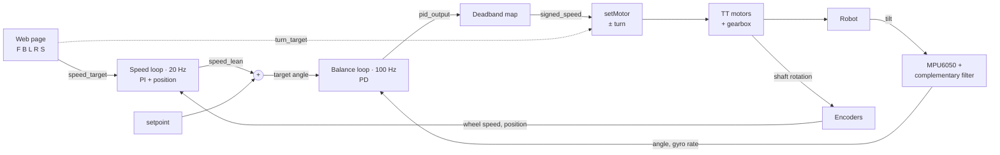

# Self-Balancing Robot

[](https://youtu.be/0gk3zJygK1k)

A two-wheeled self-balancing robot built on an ESP32. It balances using a cascaded PID controller (an inner balance loop and an outer speed loop), drives and turns from a Bluetooth web page, and recovers from light-to-medium pushes.

**Video chapters:** balancing in place (0:00) · driving (0:10) · push recovery (0:59)

## Features

- **Balancing** with a PD controller running at 100 Hz on a complementary-filtered tilt estimate
- **Speed control** with an outer PI loop (20 Hz) that sets the lean angle, so driving is a controlled lean rather than a raw motor command
- **Driving and turning** from a browser page over Bluetooth Low Energy (hold W/A/S/D or the on-screen buttons)
- **Deadband compensation** so small corrections overcome motor friction without causing jitter
- **Safety cutoff** that stops the motors past 45° and on Bluetooth disconnect

## Hardware

| Part | Notes |
|---|---|
| ESP32 dev module | Runs the firmware and the BLE server |
| MPU6050 IMU | I2C at address `0x69`, mounted upside down |
| TB6612FNG motor driver | Two H-bridges, 20 kHz PWM |
| 2 × TT gear motors with encoders | Encoders read on the motor shaft (before the gearbox) |
| 2S lithium battery (7.4 V nominal) | Motor power, into the driver's VM pin only |
| USB power bank | Logic power for the ESP32 |

### Pinout

| Signal | ESP32 pin |
|---|---|
| MPU6050 SDA / SCL | 21 / 22 |
| Motor A: AIN1, AIN2, PWMA | 25, 26, 18 |
| Motor B: BIN1, BIN2, PWMB | 32, 33, 19 |
| Encoder A: channel A, channel B | 13, 14 |
| Encoder B: channel A, channel B | 27, 16 |

> Battery voltage must only ever reach the driver's VM pin. An ESP32 GPIO is rated for 3.6 V; see [Challenges](#challenges-and-fixes).

## How it works



A balancing robot can't move by just spinning its wheels: the wheels would run out from under the body. To move forward it has to lean forward first, and the balance loop then drives the wheels to catch the fall. So the controller is **cascaded**: the speed loop never touches the motors. It only chooses the lean angle that the balance loop holds.

### 1. Tilt estimate: complementary filter

The gyro is smooth but drifts; the accelerometer knows true vertical but is noisy. Each 10 ms step trusts the integrated gyro 98% and the accelerometer 2%:

$$
\theta_k = 0.98\left(\theta_{k-1} + \omega_k\,\Delta t\right) + 0.02\,\theta_{\text{acc}}
$$

### 2. Balance loop: PD at 100 Hz

$$
e = (\theta_{\text{set}} + \theta_{\text{lean}}) - \theta, \qquad u = K_p\, e - K_d\, \omega_f
$$

The D term uses the gyro rate directly instead of differencing the angle, which is cleaner and less noisy. The I term is disabled; the speed loop already removes slow steady errors.

### 3. Deadband compensation

TT motors don't turn below roughly 30 PWM. The PID output magnitude $m$ is mapped through two joined straight lines so small commands still count, with no jump anywhere:

$$
\text{PWM}(m) =
\begin{cases}
m \cdot \dfrac{\text{MIN\_PWM}}{\text{DEAD\_BAND}} & m < \text{DEAD\_BAND} \\[2ex]
\text{MIN\_PWM} + (m - \text{DEAD\_BAND})\,\dfrac{255 - \text{MIN\_PWM}}{255 - \text{DEAD\_BAND}} & \text{otherwise}
\end{cases}
$$

### 4. Speed loop: PI + position at 20 Hz

Wheel speed (encoder ticks per 50 ms, low-pass filtered) is compared with a ramped speed command:

$$
\theta_{\text{lean}} = \operatorname{clamp}\!\Big(K_s (v - v_{\text{cmd}}) + K_i \sum (v - v_{\text{cmd}}) + K_{\text{pos}} (n - n_{\text{hold}}),\ \pm 3^\circ\Big)
$$

The integral limit is set in degrees of lean (`LEAN_I_MAX / KI_SPEED`) so it stays meaningful when the gain changes. The ramp prevents a lurch when a drive button is pressed.

### 5. Steering

Balance depends on the average of the two wheels and rotation on their difference, so turning doesn't disturb balance:

$$
\text{PWM}_A = s + t, \qquad \text{PWM}_B = s - t, \qquad \frac{\text{PWM}_A + \text{PWM}_B}{2} = s
$$

## Challenges and fixes

**Jitter from a deadband "cliff."** The first motor mapping output 0 below a PID value of 8 and jumped straight to 35 above it. Near balance the PID hovered around 8, so the motors flipped between off and a sudden kick. Moving the cliff lower made it worse (sensor noise alone could trigger it). Fix: the continuous two-segment mapping above.

**A buzz tuning couldn't remove.** The Serial Plotter showed `pid_output` swinging about ±200 at roughly 12 Hz while standing still, with the speed loop flat. The key clue was that **P and D peaked at the same time**: damping was arriving too late and adding to the swing. Cause: loop delay (sensor filter, software filter, 10 ms period) plus gearbox backlash, which lets the motor spin freely before the wheel moves. Fix: lighter gyro filtering (0.7/0.3 to 0.5/0.5), K_d 1.6 to 2.2, K_p 70 to 58. The remaining wobble is the floor set by the TT gearboxes.

**Driving stalled, then rocked.** The speed integral was originally capped at 0.4° of lean, too little to overcome motor friction, so the robot stalled short of the target speed. Raising the cap to 2.5° fixed driving but made the robot rock about 8 cm each way while standing: the speed integral acts like a position spring, and it had too little braking. Fix: KI_SPEED 0.004 to 0.002 and K_SPEED 0.04 to 0.08.

**Return-to-home was unreliable.** I tried freezing the home position during pushes so the robot would roll back. It overshot, oscillated, and settled elsewhere. Cause: the encoders sit on the motor shaft, so they count motion through gearbox backlash that the wheel never makes, and single-edge decoding miscounts some fast reversals. The position estimate drifts, so home drifts. Fix: reverted to settling in place, which is predictable.

**Asymmetric push recovery.** Pushes in one direction were handled much better. Standing still, the speed loop's lean sat around −1.85°, meaning it was spending most of its ±3° budget compensating for a wrong setpoint. Fix: moved that offset into the setpoint so the lean centers near zero.

**A dead ESP32.** 7 V from the battery touched a GPIO pin. The board went into watchdog reset loops (`TG0WDT_SYS_RESET`), its flash was corrupted, and a blank sketch crashed too, which ruled out software. Fix: replaced the board, and now battery wiring is kept away from logic pins and connected last.

## Final tuning

| Constant | Value | Role |
|---|---|---|
| `K_p` | 58 | PWM per degree of tilt error |
| `K_d` | 2.2 | PWM per deg/s of tilt rate |
| `setpoint` | 3.0° | Sensor reading when balanced |
| `DEAD_BAND` / `MIN_PWM` | 13 / 25 | Deadband compensation |
| `K_SPEED` | 0.08 | Speed loop P (braking) |
| `KI_SPEED` | 0.002 | Speed loop I |
| `LEAN_I_MAX` | 2.5° | Max lean the integral can add |
| `K_POS` | 0.005 | Position hold once stopped |
| `SPEED_RAMP` | 2 per 50 ms | Smooth drive start |
| `TURN_SPEED` | 40 PWM | Wheel difference when turning |

## Limitations and next steps

- **Gearbox backlash** in the TT motors sets the floor on standing wobble and corrupts position from the motor-shaft encoders.
- **Motor saturation:** on a hard push, `pid_output` sits at ±255 until the robot falls. The motors, not the controller, limit recovery.
- **Next:** a low-backlash actuator (3D-printed cycloidal gearbox, magnetic encoder on the output, STM32 controller) to remove both limits.

## Repository

```
esp_32_code/esp_32_code.ino   ESP32 firmware (Arduino)
balancebot_control.html       Bluetooth control page (open in Chrome or Edge)
```

**Running it:** flash `esp_32_code.ino` with the Arduino IDE (ESP32 board package, Adafruit MPU6050 library). Hold the robot still for the first 1.5 s after power-on while the gyro calibrates, then stand it up. Open `balancebot_control.html` in Chrome or Edge, press **Connect**, and choose `balancebot`.
