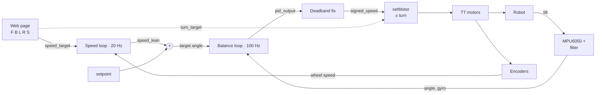

# Self-Balancing Robot

[](https://youtu.be/0gk3zJygK1k)

A two-wheeled robot that balances itself, built with an ESP32, an MPU6050 IMU and two cheap TT gear motors. It stays upright on its own, drives forward, backward and turns from a web page over Bluetooth, and recovers from light to medium pushes.

This was my first real controls project. Most of the work ended up being debugging: figuring out why it shook, why it stalled, and why it drifted. Those stories are in [Challenges](#challenges-and-what-i-learned).

**Video:** balancing in place (0:00) · driving (0:10) · push recovery (0:59)

## What it does

- Balances using a PD controller that runs 100 times a second
- Drives and turns from a web page (hold W/A/S/D or the buttons) over Bluetooth Low Energy
- Leans to move instead of just spinning the wheels, using a second, slower control loop
- Cuts the motors if it falls past 45° or loses the Bluetooth connection

## Parts

| Part | What it's for |
|---|---|
| ESP32 dev board | Runs the code and the Bluetooth connection |
| MPU6050 | Gyro + accelerometer to measure tilt (I2C address `0x69`, mounted upside down) |
| TB6612FNG | Motor driver (two H-bridges) |
| 2 × TT gear motors with encoders | Drive the wheels and measure wheel speed |
| 2S lithium battery (7.4 V) | Powers the motors (driver's VM pin only) |
| USB power bank | Powers the ESP32 |

### Wiring

| Signal | ESP32 pin |
|---|---|
| MPU6050 SDA / SCL | 21 / 22 |
| Motor A: AIN1, AIN2, PWMA | 25, 26, 18 |
| Motor B: BIN1, BIN2, PWMB | 32, 33, 19 |
| Encoder A: channel A, channel B | 13, 14 |
| Encoder B: channel A, channel B | 27, 16 |

> Keep the 7.4 V battery wires away from the ESP32. Its pins are only rated for 3.6 V, and I learned that the hard way (see below).

## How it works



The main idea: a balancing robot can't just spin its wheels to move, because the wheels would roll out from under it and it would fall backward. To go forward it has to **lean forward first**, and then the wheels drive forward to catch it. So there are two loops stacked together (a "cascaded" controller):

- The **balance loop** keeps the robot at a target angle. It's the only thing that controls the motors.
- The **speed loop** decides what that target angle should be. Want to go forward? Lean forward a bit.

### Measuring tilt

The gyro measures how fast the robot is rotating. Adding that up over time gives a smooth angle, but small errors build up and it slowly drifts. The accelerometer can tell where "down" is, so it doesn't drift, but it's noisy. A **complementary filter** combines them: every 10 ms the angle is 98% "last angle + gyro change" and 2% accelerometer.

$$
\theta_k = 0.98\left(\theta_{k-1} + \omega_k\,\Delta t\right) + 0.02\,\theta_{\text{acc}}
$$

### Balance loop (PD)

$$
e = (\theta_{\text{set}} + \theta_{\text{lean}}) - \theta, \qquad u = K_p\, e - K_d\, \omega
$$

- **P** pushes harder the further the robot is from the target angle.
- **D** pushes against how fast it's tipping, like a shock absorber, so it doesn't overshoot. I use the gyro reading directly for this since the gyro already measures tipping speed.
- I tried adding **I**, but it wasn't needed because the speed loop already fixes slow drift.

### Small commands vs. motor friction

Cheap motors don't move at all below about 30 PWM because of friction. So if the controller asks for a tiny correction, nothing happens. To fix this I remap the controller output: small values ramp gently up to 25 PWM, and bigger values continue from there up to 255. The important part is that the two lines connect, so there's no sudden jump (that jump caused a lot of shaking, see below). Here $P_{\min}$ is `MIN_PWM` (25) and $m_{\text{db}}$ is `DEAD_BAND` (13):

$$
\text{PWM}(m) =
\begin{cases}
m \cdot \dfrac{P_{\min}}{m_{\text{db}}} & m < m_{\text{db}} \\
P_{\min} + (m - m_{\text{db}}) \cdot \dfrac{255 - P_{\min}}{255 - m_{\text{db}}} & \text{otherwise}
\end{cases}
$$

### Speed loop (PI)

Every 50 ms the encoders give the wheel speed, which gets compared to the speed I'm asking for. The output is a lean angle, capped at ±3° so it can never ask the robot to lean further than it can recover from.

$$
\theta_{\text{lean}} = \mathrm{clamp}\Big(K_s (v - v_{\text{cmd}}) + K_i \sum (v - v_{\text{cmd}}),\ \pm 3^\circ\Big)
$$

- The **P** part leans more when the robot is too slow.
- The **I** part builds up over time. The motors need a constant lean just to overcome friction, and P alone would always end up a bit short of the target speed.
- When I press a button, the target speed ramps up instead of jumping, so the robot doesn't lurch.

### Turning

To turn, I add a bit of PWM to one wheel and subtract the same amount from the other. The average stays the same, so balancing isn't affected, and the difference makes it rotate.

$$
\text{PWM}_A = s + t, \qquad \text{PWM}_B = s - t
$$

## Challenges and what I learned

**It shook because of a jump in the motor mapping.** My first version sent 0 PWM below a controller output of 8 and jumped straight to 35 above it. When balanced, the output hovered right around 8, so the motors kept switching between off and a sudden kick. Moving the jump lower made it even worse, because now sensor noise alone could trigger it. I replaced it with the smooth version above. Lesson: if a small change in input causes a big jump in output, noise will make the robot jump too.

**A fast buzz that tuning couldn't fully remove.** On the Serial Plotter, the controller output was swinging about ±200 roughly 12 times a second while the robot stood still. The clue was that the P and D terms were peaking at the same time. D is supposed to push against P, so this meant the damping was arriving too late. There were two causes: delay in the loop (filters and the 10 ms update), and backlash in the cheap plastic gearboxes, where the motor turns a bit before the wheel actually moves. I reduced the gyro filtering, raised K_d and lowered K_p, which made the buzz smaller. What's left is a limit of the TT gearboxes.

**Driving stalled, then the robot started rocking.** At first the speed loop's I term was capped too low (only 0.4° of lean), so the robot couldn't push through motor friction and stalled. After raising the cap it drove fine, but started rocking about 8 cm back and forth while standing still. The I term was acting like a spring pulling it back to where it started, with not enough damping. Lowering the I gain and raising the P gain fixed it.

**Returning to its starting spot didn't work.** I tried making the robot roll back to where it started after a push. It overshot, swung back and forth, and ended up somewhere else. The problem is the encoders are on the motor shaft, before the gearbox, so when the motor wiggles back and forth through the gear slop, the encoders count movement the wheel never made. I'm also only counting one edge of one encoder channel, which miscounts some quick direction changes. The position estimate drifts, so "home" drifts. I switched it back to just stopping wherever it ends up.

**It recovered better in one direction.** While standing still, the speed loop was constantly adding about −1.85° of lean, which meant my setpoint (the angle where the robot is actually balanced) was off. That used up most of the ±3° the speed loop is allowed, leaving little room for pushes in one direction. Moving that offset into the setpoint centered things again.

**I killed an ESP32.** I accidentally touched the 7 V battery to one of the ESP32's pins. The board kept crashing and rebooting (watchdog resets), and even a blank sketch crashed, so it wasn't my code. Its flash memory had been corrupted. I replaced the board and now keep the battery wiring away from the logic side and connect it last.

## Final tuning

| Constant | Value | What it does |
|---|---|---|
| `K_p` | 58 | PWM per degree of tilt error |
| `K_d` | 2.2 | PWM per deg/s of tipping speed |
| `setpoint` | 3.0° | The angle the sensor reads when the robot is balanced |
| `DEAD_BAND` / `MIN_PWM` | 13 / 25 | Motor friction fix |
| `K_SPEED` | 0.08 | Speed loop P |
| `KI_SPEED` | 0.002 | Speed loop I |
| `LEAN_I_MAX` | 2.5° | Most lean the speed loop's I term can add |
| `K_POS` | 0.005 | Gently holds position once stopped |
| `SPEED_RAMP` | 2 per 50 ms | How fast the target speed ramps up |
| `TURN_SPEED` | 40 PWM | How hard it turns |

## Limitations and what I'd change

- **Backlash in the TT gearboxes** is behind the leftover shaking and the bad position readings.
- **The motors max out on hard pushes.** On a big push, the controller output hits the maximum (±255) and stays there until the robot falls. The code is asking for more than the motors can give.
- **Replace the USB power bank with a buck converter.** The power bank is the heaviest thing on the robot, and it's only there to power the ESP32. A small buck converter can step the 7.4 V battery down to 5 V for the ESP32 instead. Less weight means the motors have less to move, so they'd max out later and the robot could recover from bigger pushes.
- **Next project:** a low-backlash actuator (3D-printed cycloidal gearbox with an encoder on the output side and an STM32 controller) to fix the gearbox problems directly.

## Files

```
esp_32_code/esp_32_code.ino   ESP32 code (Arduino)
balancebot_control.html       Bluetooth control page (open in Chrome or Edge)
```

**To run it:** upload `esp_32_code.ino` with the Arduino IDE (ESP32 board package and the Adafruit MPU6050 library). Hold the robot still for about 1.5 seconds after turning it on while the gyro calibrates, then stand it up. Open `balancebot_control.html` in Chrome or Edge, click **Connect**, and pick `balancebot`.
